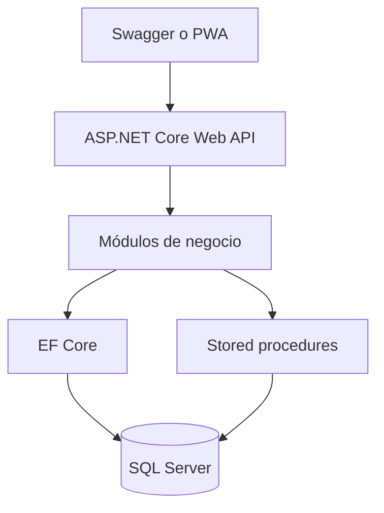
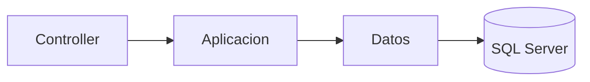
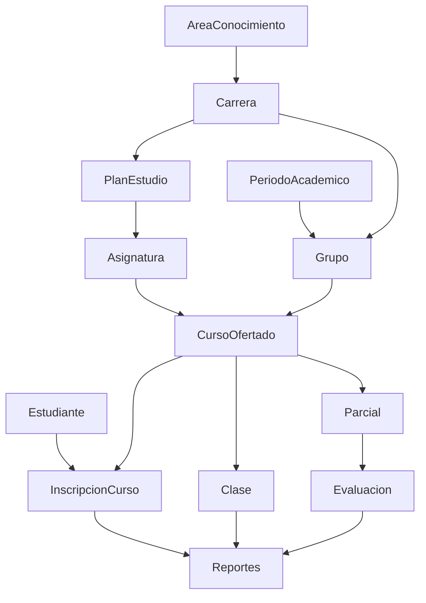
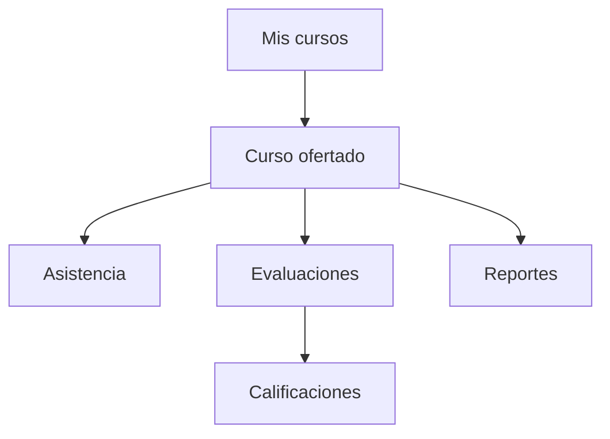

# Gestión Académica API

API REST para la gestión académica de estructura curricular, estudiantes, inscripciones, cursos ofertados, asistencia, evaluaciones, calificaciones y reportes.


## Stack

- ASP.NET Core 6
- Entity Framework Core 6 (SQL Server)
- T-SQL / stored procedures
- Swagger / OpenAPI (Swashbuckle)
- xUnit y Moq

No hay autenticación. El esquema `sec` está reservado para más adelante.

## Overview

El backend concentra la lógica de un curso ofertado: quién está inscrito, qué sesiones se dictaron, qué se evalúa y cómo va cada estudiante. El cliente (Swagger o la PWA en [GestionAcademicaFront](https://github.com/ijtrujillo99/GestionAcademicaFront)) no recalcula porcentajes ni el resultado académico.

El **CRUD** (catálogos, oferta, inscripciones, clases, evaluaciones y notas) pasa por EF Core. Los **reportes** se resuelven en SQL Server mediante stored procedures. Los porcentajes y el resultado académico **no se persisten**: se calculan al consultar.

La API **no crea ni migra** la base. El esquema, los datos de ejemplo y los procedimientos viven en `database/` y se aplican en SQL Server.

## Architecture

Monolito modular: un proyecto web (`GestionAcademica.Api`), módulos de negocio con tres capas (`Api` → `Aplicacion` → `Datos`). No es Clean Architecture, ni microservicios, ni un sistema distribuido.



Cada módulo de escritura sigue el mismo corte. Los controladores no traducen HTTP: lanzan excepciones y el middleware arma `ProblemDetails`.



```text
src/Api/
├── Salud, Catalogos, Academico
├── EstructuraAcademica, OfertaAcademica, Cursos
├── Estudiantes, Inscripciones
├── Asistencia, Evaluacion, Reportes
├── Comun            ← errores, paginación, texto
└── Infraestructura  ← DbContext, entidades, ejecutor de SP, DI
```

Esquemas SQL: `cat`, `acad`, `eval`.

## Repository structure

Solución: `GestionAcademica.sln` (proyectos `GestionAcademica.Api` y `GestionAcademica.Api.Tests`).

```text
GestionAcademica/
├── src/
│   └── Api/                 ← Web API + Swagger
├── database/                ← esquema, datos, SP, cambios
├── tests/                   ← pruebas unitarias
├── GestionAcademica.sln
└── README.md
```

| Carpeta | Rol |
|---|---|
| `src/Api` | API REST |
| `database/` | Scripts SQL (ver `database/README.md`) |
| `tests/` | Pruebas unitarias (xUnit + Moq) |

El frontend no forma parte de este repositorio: [GestionAcademicaFront](https://github.com/ijtrujillo99/GestionAcademicaFront).

## Modules

| Módulo | Responsabilidad |
|---|---|
| Salud | Conectividad con SQL Server |
| Catalogos | Resumen de catálogos (`GET /api/catalogos`) |
| Academico | Resumen académico (`GET /api/academico`) |
| EstructuraAcademica | Área, carrera, plan de estudio, asignatura |
| OfertaAcademica | Período, grupo (`IdCarrera`), aula, docente |
| Cursos | Curso ofertado y horarios |
| Estudiantes | Personas (listado paginado) |
| Inscripciones | Vínculo estudiante–curso |
| Asistencia | Sesiones (clases) y pasar lista |
| Evaluacion | Parciales, evaluaciones y calificaciones |
| Reportes | Asistencia, calificaciones y situación académica (SP) |
| Comun | `ProblemDetails`, paginación, reglas transversales |
| Infraestructura | Persistencia EF Core y ejecución de procedimientos |

Las calificaciones no son un módulo aparte: viven en **Evaluacion**.

## Domain

El hub es `CursoOfertado`. La inscripción une a un **estudiante** con un **curso**, no con un grupo suelto.



Uso típico desde el curso:



## Requirements

- [.NET SDK 6](https://dotnet.microsoft.com/download/dotnet/6.0)
- SQL Server en ejecución
- Base `GestionAcademica` creada con los scripts de `database/` (la API no migra)

En Windows suele usarse el servicio `MSSQLSERVER`. No hace falta Node ni npm para este repositorio.

## Configuration

Archivos: `src/Api/appsettings.json` y `src/Api/appsettings.Development.json`.

La API lee `ConnectionStrings:GestionAcademica`. Configura **tu** instancia local de SQL Server, autenticación de Windows o SQL, y el nombre de la base. Ejemplo de forma (ajusta servidor e instancia):

```json
{
  "ConnectionStrings": {
    "GestionAcademica": "Server=localhost;Database=GestionAcademica;Trusted_Connection=True;TrustServerCertificate=True;"
  }
}
```

No subas contraseñas. Si usas autenticación SQL, deja las credenciales fuera del repositorio (secretos de usuario, variables de entorno o User Secrets).

Otras convenciones de desarrollo:

| Tema | Valor |
|---|---|
| Entorno | `ASPNETCORE_ENVIRONMENT=Development` |
| HTTPS / HTTP | `https://localhost:7040` y `http://localhost:5226` (`launchSettings.json`) |
| Swagger | Solo en Development: `https://localhost:7040/swagger` |
| CORS | Orígenes `http://localhost:5173` y `https://localhost:5173` (política `PwaLocal`) |

## Run locally

```bash
dotnet restore
dotnet build
dotnet run --project src/Api
```

Swagger: [https://localhost:7040/swagger](https://localhost:7040/swagger)

Comprueba SQL con `GET /api/salud`. Si responde conectada y un conteo de estudiantes, la API está leyendo la base.

## Tests

```bash
dotnet test tests/GestionAcademica.Api.Tests/GestionAcademica.Api.Tests.csproj
```

Son pruebas unitarias de reglas (horario, inscripción, calificaciones, paginación, `ProblemDetails`, clasificador de situación académica). No hay suite de integración contra SQL Server.

## Database

Orden, scripts y procedimientos: [`database/README.md`](database/README.md).

```text
01_esquema/     crear base, esquemas y tablas
02_datos/       catálogos y datos de ejemplo
03_diagnostico/ validación en SSMS (la API no lo usa)
04_reportes/    stored procedures
05_cambios/     ALTER sobre una base que ya existía
```

Los reportes son `CREATE OR ALTER`. Si cambias un SP, vuelve a ejecutarlo en SSMS; no hace falta recrear la base.

| Script | Procedimiento | GET |
|---|---|---|
| `12` | `acad.sp_ReporteAsistenciaEstudiante` | `.../reportes/asistencia-estudiante` |
| `13` | `acad.sp_ReporteAsistenciaSesion` | `.../reportes/asistencia-sesion` |
| `14` | `acad.sp_ReporteAsistenciaSemanal` | `.../reportes/asistencia-semanal` |
| `15` | `eval.sp_ReporteCalificaciones` | `.../reportes/calificaciones` |
| `16` | `eval.sp_ReporteSituacionAcademica` | `.../reportes/situacion-academica` |

Nombres que usa C#: `src/Api/Infraestructura/Reportes/NombresProcedimientos.cs`.

Los scripts de `02_datos/` usan identidades y notas de ejemplo. No corresponden a personas reales.

## HTTP API

No hay `DELETE` físico. Donde existe `Activo`, se desactiva. `PlanEstudioDetalle` y `Horario` no tienen `Activo`; se corrigen con PUT.

El POST de evaluaciones responde **200** (no `201`). Queda pendiente alinearlo.

| Área | Método | Ruta |
|---|---|---|
| Salud | GET | `/api/salud` |
| Catálogos | GET | `/api/catalogos` |
| Académico | GET | `/api/academico` |
| Áreas de conocimiento | GET, POST | `/api/areas-conocimiento` |
| Área | GET, PUT | `/api/areas-conocimiento/{id}` |
| Carreras | GET, POST | `/api/carreras` |
| Carrera | GET, PUT | `/api/carreras/{id}` |
| Planes de la carrera | GET, POST | `/api/carreras/{id}/planes-estudio` |
| Plan de estudio | GET, PUT | `/api/planes-estudio/{id}` |
| Asignaturas del plan | GET, POST | `/api/planes-estudio/{id}/asignaturas` |
| Detalle de plan | PUT | `/api/planes-estudio-detalle/{id}` |
| Asignaturas | GET, POST | `/api/asignaturas` |
| Asignatura | GET, PUT | `/api/asignaturas/{id}` |
| Períodos | GET, POST | `/api/periodos-academicos` |
| Período | GET, PUT | `/api/periodos-academicos/{id}` |
| Grupos | GET, POST | `/api/grupos` |
| Grupo | GET, PUT | `/api/grupos/{id}` |
| Aulas | GET, POST | `/api/aulas` |
| Aula | GET, PUT | `/api/aulas/{id}` |
| Docentes | GET, POST | `/api/docentes` |
| Docente | GET, PUT | `/api/docentes/{id}` |
| Cursos | GET, POST | `/api/cursos-ofertados` (lista: horarios y carrera) |
| Curso ofertado | GET, PUT | `/api/cursos-ofertados/{id}` |
| Horarios del curso | GET, POST | `/api/cursos-ofertados/{id}/horarios` |
| Horario | PUT | `/api/horarios/{id}` |
| Estudiantes | GET, POST | `/api/estudiantes` (GET: `?page=&pageSize=&q=`) |
| Estudiante | GET, PUT | `/api/estudiantes/{id}` |
| Inscripciones del curso | GET, POST | `/api/cursos-ofertados/{id}/inscripciones` |
| Inscripción | PUT | `/api/inscripciones/{id}` |
| Clases | GET, POST | `/api/cursos-ofertados/{id}/clases` |
| Clase | PUT | `/api/clases/{id}` |
| Asistencia | GET, PUT | `/api/clases/{id}/asistencias` |
| Parciales | GET | `/api/cursos-ofertados/{id}/parciales` |
| Evaluaciones del parcial | GET, POST | `/api/parciales/{id}/evaluaciones` |
| Evaluaciones | GET | `/api/evaluaciones` |
| Evaluación | GET, PUT | `/api/evaluaciones/{id}` |
| Calificaciones | GET, PUT | `/api/evaluaciones/{id}/calificaciones` |
| Reportes | GET | `/api/cursos-ofertados/{id}/reportes/...` |

Reportes (query opcional `fechaDesde` / `fechaHasta` en los de asistencia):

```text
.../reportes/asistencia-estudiante
.../reportes/asistencia-sesion
.../reportes/asistencia-semanal
.../reportes/calificaciones
.../reportes/situacion-academica
```

## Errors

Los fallos no usan `{ "mensaje": "..." }`. El middleware (`ManejadorExcepcionesMiddleware`) y la validación de `[ApiController]` responden **siempre** `application/problem+json` (RFC 7807).

```json
{
  "type": "https://httpstatuses.com/400",
  "title": "Regla de negocio",
  "status": 400,
  "detail": "La suma de puntajes (65.00) supera el máximo del parcial (50.00).",
  "instance": "/api/evaluaciones/12",
  "traceId": "..."
}
```

El cliente debe leer **`detail`**.

| Caso | HTTP | `title` |
|---|---|---|
| `ReglaNegocioException` | 400 | Regla de negocio |
| Modelo inválido (`[ApiController]`) | 400 | Datos inválidos |
| `KeyNotFoundException` | 404 | Recurso no encontrado |
| `SqlException` / `DbException` | 503 | Servicio no disponible |
| Cualquier otra | 500 | Error interno |

La validación 400 incluye `errors` (campo → mensajes). `GET /api/salud` en éxito es `SaludDto`; si no hay SQL, 503 con `ProblemDetails`. Un `THROW` de un SP (por ejemplo curso inexistente en un reporte) también se mapea a **503**, no a 404.

## Pagination

Infraestructura reutilizable: `PagedResult<T>` y `ToPagedResultAsync` (`src/Api/Comun/Paginacion`). El `Skip`/`Take` se ejecuta en SQL Server. Hoy **solo** `GET /api/estudiantes` la usa.

```text
GET /api/estudiantes
GET /api/estudiantes?page=1&pageSize=10
GET /api/estudiantes?q=abel&page=1&pageSize=10
```

| Campo | Significado |
|---|---|
| `page` | Default `1` |
| `pageSize` | Default `10`, máximo `100` |
| `items` | Filas de la página |
| `totalItems` | Total **después** del filtro `q` |
| `totalPages` | `ceil(totalItems / pageSize)` (`0` si no hay filas) |

Orden: `Nombre`, luego `IdEstudiante`. `q` vacío = sin filtro (carnet o nombre). Parámetros inválidos → 400. Página más allá del total → **200** con `items: []`.

```json
{
  "items": [],
  "page": 5,
  "pageSize": 10,
  "totalItems": 36,
  "totalPages": 4
}
```

## Domain rules

### Estudiantes e inscripciones

- El estudiante es la persona. La inscripción lo une a un `CursoOfertado`.
- Unique `(IdEstudiante, IdCursoOfertado)`: una fila por par. Reintegrar es PUT, no un segundo POST.
- `Estudiante.Activo` no equivale a inscripción `Retirada`.
- PUT de inscripción: a `Retirada` pone `FechaRetiro` (hoy si no había); a `Activa` o `Pendiente` la limpia.

### Gestión académica

Estructura (área → carrera → plan → asignatura) y oferta (periodo → grupo con `IdCarrera` → curso + horario). El grupo no infiere la carrera del código. El curso ofertado no se liga a un detalle de plan.

### Asistencia

- Ausente ≠ sin registro (fila inexistente) ≠ retirado.
- POST de clase: el horario se resuelve por el día de la fecha; si no hay bloque ese día → 400.
- PUT de clase: solo tema y descripción; no mueve la fecha.
- PUT de asistencias: upsert. No inventa ausencias. Rechaza retirados e inscripciones de otro curso.
- Después de `FechaRetiro` no se espera asistencia (`Fecha < FechaRetiro`).

### Evaluación y calificaciones

- Semestre = 100: Parcial I 50 + Parcial II 50.
- `null` = sin fila = sin evaluar. `0` es un cero.
- PUT de evaluación: la suma no pasa el tope del parcial; el orden es único; no se baja `PuntajeMaximo` por debajo de notas ya cargadas.
- No hay DELETE de evaluaciones. La anulación lógica (`Activo`) está pendiente.
- Inscripción **Retirada**: no se **crea** una calificación nueva; sí se **actualiza** una fila existente.

### Situación académica

Pregunta: *¿cómo va cada estudiante?* El GET ejecuta `eval.sp_ReporteSituacionAcademica`. El `CASE` del SP es la fuente de verdad en producción.

En tests unitarios las mismas reglas están en `ClasificadorResultadoAcademico`. Si se cambia el SP, hay que actualizar el clasificador (y al revés). No hay prueba de integración API + SP.

```text
NotaFinal = Parcial I + Parcial II
          = máximo 100
```

La **Tarea de Curso** (tipo `Tarea de Curso`) **ya está dentro del Parcial II**. No se suma otra vez; solo condiciona la aprobación.

```text
Retirada                         → Retirado
Evaluaciones pendientes > 0      → En curso
NotaFinal < 60                   → Reprobado
Tarea de Curso sin calificar     → En curso
Tarea de Curso = 0               → No aprobado - Tarea de Curso
cualquier otro caso              → Aprobado
```

Aprobar exige nota ≥ 60 **y** Tarea de Curso calificada con puntaje > 0.

## Status

| Bloque | Estado |
|---|---|
| Asistencia | Cerrado |
| Evaluación y calificaciones | Cerrado (falta anulación lógica) |
| Reportes | Cerrado a nivel funcional |
| Situación académica | Cerrado a nivel funcional |
| Contrato de errores (`ProblemDetails`) | Cerrado |
| Paginación de listados | Solo estudiantes; el helper sirve para otros GET |
| `201 Created` en POST evaluaciones | Pendiente |
| Anulación lógica de evaluaciones | Pendiente |
| Prueba de integración API + SP | Pendiente |
| Autenticación (`sec`) | Futura |
| Frontend (PWA) | Repositorio independiente: [GestionAcademicaFront](https://github.com/ijtrujillo99/GestionAcademicaFront) |
