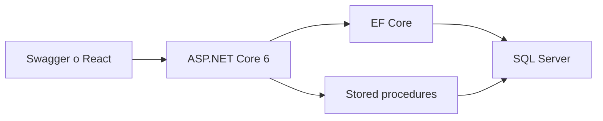
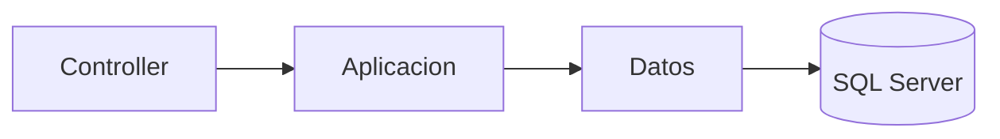
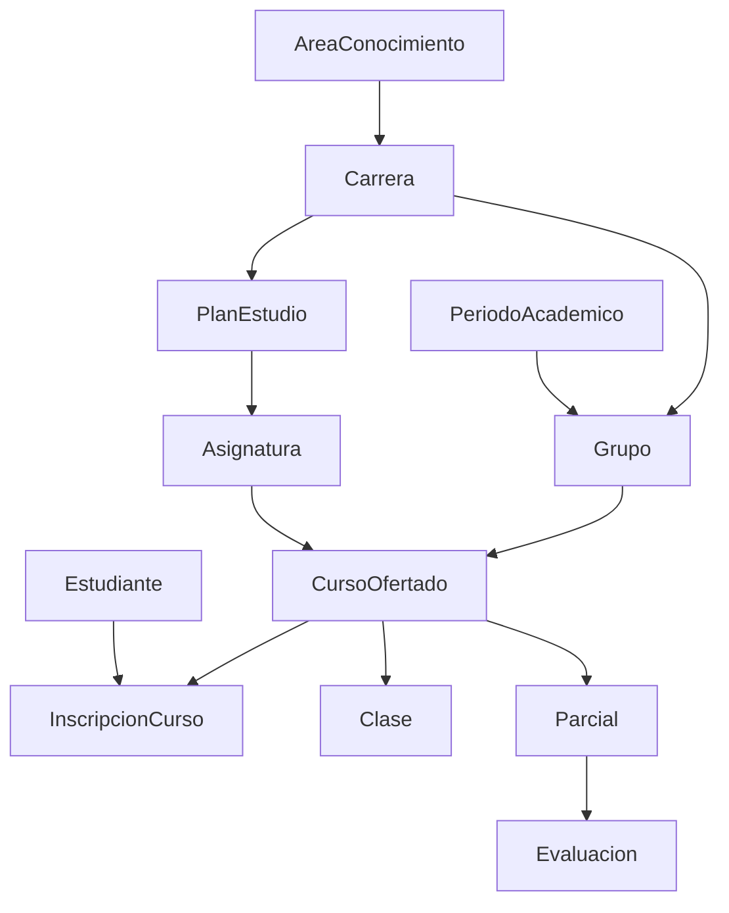
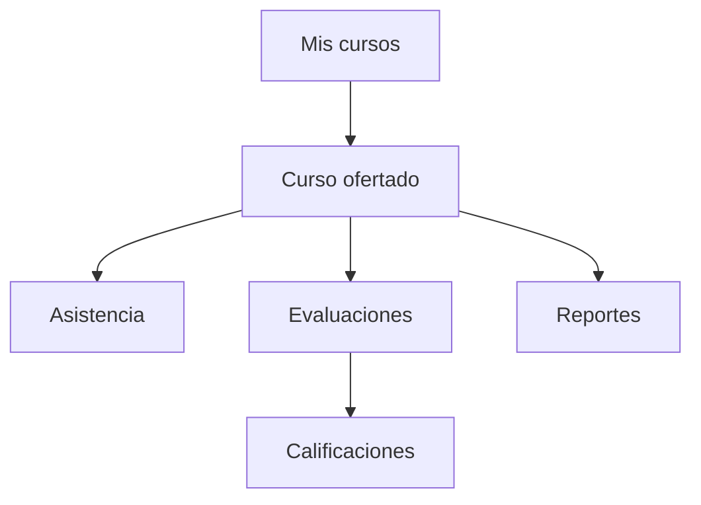

# Gestión Académica

Sistema para docentes: asistencia, evaluación y reportes.

Arquitectura: **monolito modular** en ASP.NET Core 6. Un solo proyecto de API, tres capas por módulo (`Api` → `Aplicacion` → `Datos`) y una base SQL Server. Los porcentajes y el resultado académico **no se persisten**: se calculan al consultar.

```text
GestionAcademica.sln
├── database/                         ← scripts SQL (esquema, datos, reportes)
├── src/Api/                          ← Web API + Swagger
├── src/Web/                          ← PWA (pendiente)
└── tests/GestionAcademica.Api.Tests/ ← xUnit + Moq
```

Hoy se usa Swagger. No hay autenticación: el esquema `sec` queda para más adelante.

## Diagramas

GitHub renderiza estos diagramas (Mermaid) al abrir el README.

### Arquitectura

Un cliente llama a la API. El CRUD va por EF Core. Los reportes no se calculan en C#: la API ejecuta stored procedures.



Cada módulo de la API tiene tres capas. Los controladores no traducen HTTP: lanzan excepciones y el middleware arma `ProblemDetails`.



### Dominio

El hub es `CursoOfertado`. La inscripción une a un estudiante con un curso, no con un grupo suelto.



### Flujo de uso

Desde el curso se toma asistencia, se cargan notas y se consultan reportes. Los porcentajes y el resultado académico se calculan al consultar, no se guardan en tablas.



## Requisitos

- .NET SDK 6
- SQL Server (`MSSQLSERVER`) en ejecución
- Base `GestionAcademica` creada con los scripts de `database/` (la API no migra)

Cadena de conexión: `src/Api/appsettings.json` → `DESKTOP-INGRIDT` / `GestionAcademica`, autenticación de Windows.

## Arranque

```powershell
dotnet run --project src/Api
```

Swagger: `https://localhost:7040/swagger`

Si `GET /api/salud` muestra 36 estudiantes, la API está leyendo los datos de ejemplo.

```powershell
dotnet test tests/GestionAcademica.Api.Tests/GestionAcademica.Api.Tests.csproj
```

## API

El hub es `CursoOfertado`. La inscripción (`InscripcionCurso`) une estudiante y curso (`EsOficial`, estado, `FechaRetiro`).

| Área | Método | Ruta |
|---|---|---|
| Salud | GET | `/api/salud` |
| Catálogos | GET | `/api/catalogos` |
| Académico | GET | `/api/academico` |
| Áreas de conocimiento | GET, POST | `/api/areas-conocimiento` |
| Área | GET, PUT | `/api/areas-conocimiento/{id}` |
| Carreras | GET, POST | `/api/carreras` |
| Carrera | GET, PUT | `/api/carreras/{id}` |
| Planes de la carrera | GET, POST | `/api/carreras/{id}/planes-estudio` |
| Plan de estudio | GET, PUT | `/api/planes-estudio/{id}` |
| Asignaturas del plan | GET, POST | `/api/planes-estudio/{id}/asignaturas` |
| Detalle de plan | PUT | `/api/planes-estudio-detalle/{id}` |
| Asignaturas | GET, POST | `/api/asignaturas` |
| Asignatura | GET, PUT | `/api/asignaturas/{id}` |
| Períodos | GET, POST | `/api/periodos-academicos` |
| Período | GET, PUT | `/api/periodos-academicos/{id}` |
| Grupos | GET, POST | `/api/grupos` |
| Grupo | GET, PUT | `/api/grupos/{id}` |
| Aulas | GET, POST | `/api/aulas` |
| Aula | GET, PUT | `/api/aulas/{id}` |
| Docentes | GET, POST | `/api/docentes` |
| Docente | GET, PUT | `/api/docentes/{id}` |
| Cursos | GET, POST | `/api/cursos-ofertados` (lista incluye horarios y carrera) |
| Curso ofertado | GET, PUT | `/api/cursos-ofertados/{id}` |
| Horarios del curso | GET, POST | `/api/cursos-ofertados/{id}/horarios` |
| Horario | PUT | `/api/horarios/{id}` |
| Estudiantes | GET, POST | `/api/estudiantes` (GET paginado: `?page=1&pageSize=10&q=`) |
| Estudiante | GET, PUT | `/api/estudiantes/{id}` |
| Inscripciones del curso | GET, POST | `/api/cursos-ofertados/{id}/inscripciones` |
| Inscripción | PUT | `/api/inscripciones/{id}` |
| Clases | GET, POST | `/api/cursos-ofertados/{id}/clases` |
| Clase | PUT | `/api/clases/{id}` |
| Asistencia | GET, PUT | `/api/clases/{id}/asistencias` |
| Parciales | GET | `/api/cursos-ofertados/{id}/parciales` |
| Evaluaciones del parcial | GET, POST | `/api/parciales/{id}/evaluaciones` |
| Evaluaciones | GET | `/api/evaluaciones` |
| Evaluación | GET, PUT | `/api/evaluaciones/{id}` |
| Calificaciones | GET, PUT | `/api/evaluaciones/{id}/calificaciones` |
| Reportes | GET | `/api/cursos-ofertados/{id}/reportes/...` |

Reportes (todos delegan a stored procedures; ver `database/README.md`):

```text
.../reportes/asistencia-estudiante
.../reportes/asistencia-sesion
.../reportes/asistencia-semanal
.../reportes/calificaciones
.../reportes/situacion-academica
```

No hay `DELETE` de evaluaciones. La anulación lógica (`Activo`) está pendiente.

### Errores (contrato para React)

Los fallos no usan `{ "mensaje": "..." }`. Un middleware global (`ManejadorExcepcionesMiddleware`) y la validación de `[ApiController]` responden **siempre** `application/problem+json` (RFC 7807):

```json
{
  "type": "https://httpstatuses.com/400",
  "title": "Regla de negocio",
  "status": 400,
  "detail": "La suma de puntajes (65.00) supera el máximo del parcial (50.00).",
  "instance": "/api/evaluaciones/12",
  "traceId": "..."
}
```

En el front lee **`detail`**.

| Excepción / caso | HTTP | `title` |
|---|---|---|
| `ReglaNegocioException` | 400 | Regla de negocio |
| Modelo inválido (`[ApiController]`) | 400 | Datos inválidos |
| `KeyNotFoundException` | 404 | Recurso no encontrado |
| `SqlException` / `DbException` | 503 | Servicio no disponible |
| Cualquier otra | 500 | Error interno |

La validación 400 incluye además `errors` (campo → mensajes). `GET /api/salud` en éxito sigue siendo `SaludDto`; si no hay SQL, también 503 con `ProblemDetails` (`detail` explicando la caída).

Los controladores no llevan `try/catch` de HTTP: lanzan la excepción y el middleware la traduce.

### Paginación (server-side)

Solo `GET /api/estudiantes` está paginado por ahora. El contrato es reutilizable (`PagedResult<T>` + `ToPagedResultAsync`) para otros listados.

```text
GET /api/estudiantes
GET /api/estudiantes?page=1&pageSize=10
GET /api/estudiantes?q=abel&page=1&pageSize=10
```

| Campo | Significado |
|---|---|
| `page` | Página pedida (default `1`) |
| `pageSize` | Tamaño (default `10`, máximo `100`) |
| `items` | Filas de esa página |
| `totalItems` | Total **después** del filtro `q` |
| `totalPages` | `ceil(totalItems / pageSize)` (`0` si no hay filas) |

SQL Server aplica `ORDER BY`, `OFFSET` y `FETCH`. No se pagina en memoria. Orden de estudiantes: `Nombre`, luego `IdEstudiante`.

`page` o `pageSize` inválidos → `400` ProblemDetails. Una página más allá del total → `200` con `items: []`.

```json
{
  "items": [],
  "page": 5,
  "pageSize": 10,
  "totalItems": 36,
  "totalPages": 4
}
```

### Estudiantes e inscripciones

- El estudiante es la persona. La inscripción lo une a un `CursoOfertado` (no a grupo ni asignatura sueltos).
- Unique `(IdEstudiante, IdCursoOfertado)`: una sola fila por par. Reintegrar es PUT, no un segundo POST.
- `Estudiante.Activo` desactiva a la persona; no equivale a inscripción `Retirada`.
- El PUT de inscripción calcula `FechaRetiro` y `FechaEstado`. A `Retirada` pone retiro (hoy si no había); a `Activa` o `Pendiente` limpia el retiro.
- `GET /api/estudiantes?q=` busca por carnet o nombre.

### Gestión académica

Estructura (área → carrera → plan → asignatura) y oferta (periodo → grupo con `IdCarrera` → curso ofertado + horario). Sin DELETE físico: se usa `Activo` donde existe. `PlanEstudioDetalle` y `Horario` no tienen `Activo`; solo se corrigen con PUT. El grupo no infiere la carrera del código. El curso ofertado no se liga a un detalle de plan.

### Asistencia

- Ausente ≠ sin registro (fila inexistente) ≠ retirado.
- El POST de clases crea la sesión. El horario se resuelve con el día de la fecha; si el curso no tiene bloque ese día, 400.
- El PUT de clase solo cambia tema y descripción. No mueve la fecha.
- El PUT de asistencias hace upsert. No inventa ausencias.
- Rechaza retirados e inscripciones de otro curso (`ReglaNegocioException` → 400).
- Después de `FechaRetiro` no se espera asistencia (`Fecha < FechaRetiro`).

### Evaluación y calificaciones

- Semestre = 100 puntos: Parcial I = 50, Parcial II = 50.
- `null` en una calificación = sin fila = sin evaluar. `0` es un cero.
- PUT de evaluación: la suma de puntajes no puede pasar el tope del parcial; el orden es único; no se baja `PuntajeMaximo` por debajo de notas ya cargadas.

### Situación académica

Pregunta: *¿cómo va cada estudiante?*

En **producción** el GET ejecuta `eval.sp_ReporteSituacionAcademica`. El `CASE` del SP es la fuente de verdad.

En **pruebas unitarias** las mismas reglas viven en `ClasificadorResultadoAcademico` (C#), para no depender de SQL Server. Si se cambia el `CASE` del SP, hay que actualizar el clasificador (y al revés). Más adelante conviene una prueba de integración contra la API + la base.

Nota del semestre:

```text
NotaFinal = Parcial I + Parcial II
          = máximo 100
```

La **Tarea de Curso** (tipo `Tarea de Curso`, suele valer 20) **ya está dentro del Parcial II**. No se suma otra vez. Solo sirve para la condición obligatoria de aprobación.

Prioridad del resultado:

```text
Retirada                         → Retirado
Evaluaciones pendientes > 0      → En curso
NotaFinal < 60                   → Reprobado
Tarea de Curso sin calificar     → En curso
Tarea de Curso = 0               → No aprobado - Tarea de Curso
cualquier otro caso              → Aprobado
```

Aprobar exige nota ≥ 60 **y** Tarea de Curso calificada con puntaje > 0.

## Estado

| Bloque | Estado |
|---|---|
| Asistencia | Cerrado |
| Evaluación y calificaciones | Cerrado (falta anulación lógica) |
| Reportes | Cerrado a nivel funcional |
| Situación académica | Cerrado a nivel funcional |
| Contrato global de errores (`ProblemDetails`) | Cerrado |
| Revisión Swagger / `201 Created` en POST evaluaciones | Pendiente |
| Anulación lógica de evaluaciones | Pendiente |
| Prueba de integración API + SP | Pendiente |
| Autenticación / `sec` | Futura |
| PWA (`src/Web`) | Futura |

No se agregan más endpoints académicos. Siguiente paso: revisión de controladores/Swagger (incluido devolver `201` al crear una evaluación) y después React.
