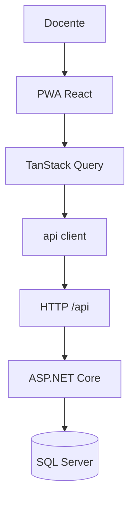
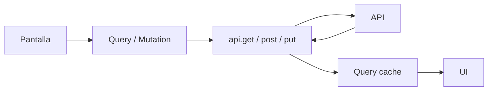
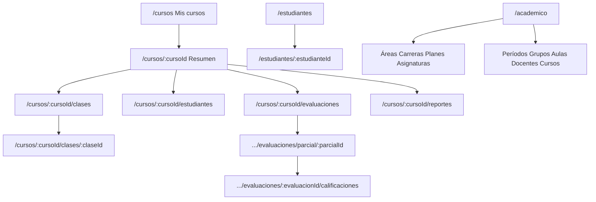

# Frontend — Gestión Académica

El código de la PWA no está en este directorio. Vive en el repositorio hermano:

```text
../GestionAcademicaFront
```

Este archivo es el mapa del frontend, alineado con el `README.md` de la raíz (API).

```text
React PWA     http://localhost:5173     (GestionAcademicaFront)
      │
      ▼  /api  (proxy de Vite en desarrollo)
ASP.NET Core API     https://localhost:7040     (este repo, src/Api)
      │
      ▼
SQL Server           GestionAcademica
```

No hay autenticación. No hay modo offline académico: la PWA cachea assets, no datos de negocio.

## 1. Qué es

Cliente PWA de Gestión Académica.

El docente consulta sus cursos, pasa lista, carga notas y ve reportes. También gestiona personas (estudiantes e inscripciones) y los catálogos de estructura y oferta académica.

La aplicación concentra presentación, navegación y estado de cliente. La lógica de negocio y los cálculos de reportes están en la API / SQL.

## 2. Stack

Versiones según `GestionAcademicaFront/package.json`:

| Pieza | Paquete | Versión |
|---|---|---|
| UI | `react` / `react-dom` | 19.2.8 |
| Lenguaje | `typescript` | ~6.0.2 |
| Bundler | `vite` | ^8.2.2 |
| Rutas | `react-router-dom` | ^7.18.2 |
| Datos | `@tanstack/react-query` | ^5.90.5 |
| Componentes | `@mui/material` | ^9.3.1 |
| Tablas densas | `@mui/x-data-grid` | ^9.12.0 |
| Formularios | `react-hook-form` + `zod` | ^7.86.0 / ^3.25.76 |
| PWA | `vite-plugin-pwa` | ^1.3.0 |
| Lint | `oxlint` | ^1.79.0 |

Alias `@/` → `src/` del front.

## 3. Estructura

```text
GestionAcademicaFront/
├── public/
├── src/
│   ├── app/                 ← router, theme, shell, navegación
│   ├── features/
│   │   ├── cursos/          ← Mis cursos y layout del curso
│   │   ├── asistencia/      ← sesiones y pasar lista
│   │   ├── estudiantes/     ← gestión, matrícula, lista del curso
│   │   ├── academico/       ← hub de catálogos
│   │   ├── estructuraAcademica/
│   │   ├── ofertaAcademica/
│   │   ├── evaluaciones/
│   │   └── reportes/
│   └── shared/              ← cliente HTTP, query keys, Paginacion
├── .env.example
├── package.json
└── vite.config.ts
```

Cada feature típica: `api/` → `hooks/` → `pages/` + `components/`.

El cliente HTTP (`get` / `post` / `put`) está en `src/shared/api/client.ts`. No hay `delete` en el front.

## 4. Arquitectura



En desarrollo Vite reenvía `/api` a `https://localhost:7040` (`secure: false`).

Si se define `VITE_API_URL`, el navegador llama directo a ese origen (hace falta CORS y el certificado de desarrollo). CORS en esta API ya permite `http://localhost:5173`.



## 5. Requisitos y arranque

En `GestionAcademica`:

```powershell
dotnet run --project src/Api
```

En `GestionAcademicaFront`:

```powershell
npm install
npm run dev
```

Abre `http://localhost:5173`. `/` redirige a `/cursos`.

```powershell
npm run build
npm run preview
npx tsc -b
npx oxlint
```

URL de la API: `.env.example` del front. Vacío = proxy. No hay secretos en el front.

```text
# VITE_API_URL=https://localhost:7040
```

## 6. Pantallas y rutas

Navegación global:

- Desktop `lg+`: sidebar 248 px
- Tablet `md`: sidebar compacta 72 px
- Móvil `< md`: bottom nav (Mis cursos | Estudiantes | Académico)

Dentro de un curso, al pasar lista (`/cursos/:cursoId/clases/:claseId`) se ocultan las tabs del curso.



| Pantalla | Ruta UI | Propósito | API principal |
|---|---|---|---|
| Mis cursos | `/cursos` | Cursos del docente | `GET /api/cursos-ofertados` |
| Resumen del curso | `/cursos/:cursoId` | Acciones del curso | misma lista (cliente) |
| Sesiones | `/cursos/:cursoId/clases` | Elegir o crear clase | `GET/POST .../clases` |
| Pasar lista | `/cursos/:cursoId/clases/:claseId` | Asistencia de la sesión | `GET/PUT /api/clases/{id}/asistencias` |
| Estudiantes del curso | `/cursos/:cursoId/estudiantes` | Consulta de inscritos | `GET .../inscripciones` |
| Evaluaciones | `/cursos/:cursoId/evaluaciones` | Parciales del curso | `GET .../parciales` |
| Evaluaciones del parcial | `.../evaluaciones/parcial/:parcialId` | CRUD de evaluaciones | `GET/POST /api/parciales/{id}/evaluaciones` |
| Calificaciones | `.../evaluaciones/:evaluacionId/calificaciones` | Cargar notas | `GET/PUT /api/evaluaciones/{id}/calificaciones` |
| Hub de reportes | `/cursos/:cursoId/reportes` | Elegir reporte | — |
| Asistencia por estudiante | `.../reportes/asistencia-estudiante` | Reporte | `GET .../reportes/asistencia-estudiante` |
| Asistencia por sesión | `.../reportes/asistencia-sesion` | Reporte | `GET .../reportes/asistencia-sesion` |
| Asistencia semanal | `.../reportes/asistencia-semanal` | Reporte | `GET .../reportes/asistencia-semanal` |
| Calificaciones (reporte) | `.../reportes/calificaciones` | Matriz | `GET .../reportes/calificaciones` |
| Situación académica | `.../reportes/situacion-academica` | Resultado | `GET .../reportes/situacion-academica` |
| Gestión de estudiantes | `/estudiantes` | Personas y matrícula | `GET /api/estudiantes?page=&pageSize=&q=` |
| Ficha del estudiante | `/estudiantes/:estudianteId` | Datos + inscribir | `GET/PUT /api/estudiantes/{id}` |
| Hub académico | `/academico` | Entrada a catálogos | conteos con listados ya existentes |
| Áreas | `/academico/areas` | Catálogo | `/api/areas-conocimiento` |
| Carreras | `/academico/carreras` | Catálogo | `/api/carreras` |
| Planes | `/academico/planes-estudio` | Planes por carrera | `/api/carreras/{id}/planes-estudio` |
| Asignaturas del plan | `/academico/planes-estudio/:planId/asignaturas` | Detalle de plan | `/api/planes-estudio/{id}/asignaturas` |
| Asignaturas | `/academico/asignaturas` | Catálogo | `/api/asignaturas` |
| Períodos | `/academico/periodos` | Catálogo | `/api/periodos-academicos` |
| Grupos | `/academico/grupos` | Catálogo | `/api/grupos` |
| Aulas | `/academico/aulas` | Catálogo | `/api/aulas` |
| Docentes | `/academico/docentes` | Catálogo | `/api/docentes` |
| Cursos ofertados | `/academico/cursos-ofertados` | Oferta (misma lista que Mis cursos) | `GET/POST/PUT /api/cursos-ofertados` |
| Horarios | `/academico/cursos-ofertados/:cursoId/horarios` | Bloques del curso | `GET/POST .../horarios`, `PUT /api/horarios/{id}` |

`GET /api/catalogos` y `GET /api/academico` existen en esta API y **no** se consumen en el front.

`GET /api/evaluaciones` (listado global) **no** se consume; el front entra por parcial del curso.

## 7. Integración con la API

### Operación del docente

```text
Mis cursos
    GET /api/cursos-ofertados

Sesiones
    GET  /api/cursos-ofertados/{id}/clases
    POST /api/cursos-ofertados/{id}/clases
    PUT  /api/clases/{id}

Asistencia
    GET /api/clases/{id}/asistencias
    PUT /api/clases/{id}/asistencias     ← solo filas modificadas, nunca null

Evaluaciones
    GET  /api/cursos-ofertados/{id}/parciales
    GET  /api/parciales/{id}/evaluaciones
    POST /api/parciales/{id}/evaluaciones
    GET  /api/evaluaciones/{id}
    PUT  /api/evaluaciones/{id}
    GET  /api/evaluaciones/{id}/calificaciones
    PUT  /api/evaluaciones/{id}/calificaciones

Reportes
    GET /api/cursos-ofertados/{id}/reportes/asistencia-estudiante
    GET /api/cursos-ofertados/{id}/reportes/asistencia-sesion
    GET /api/cursos-ofertados/{id}/reportes/asistencia-semanal
    GET /api/cursos-ofertados/{id}/reportes/calificaciones
    GET /api/cursos-ofertados/{id}/reportes/situacion-academica
```

Los reportes de asistencia aceptan `fechaDesde` y `fechaHasta` en query cuando el filtro de la UI los envía.

### Personas

```text
Gestión de estudiantes
    GET  /api/estudiantes?page=&pageSize=&q=
    POST /api/estudiantes
    GET  /api/estudiantes/{id}
    PUT  /api/estudiantes/{id}

Matrícula (ficha del estudiante)
    GET  /api/cursos-ofertados/{id}/inscripciones
    POST /api/cursos-ofertados/{id}/inscripciones
    PUT  /api/inscripciones/{id}
```

### Catálogos

```text
GET/POST /api/areas-conocimiento     PUT /api/areas-conocimiento/{id}
GET/POST /api/carreras               PUT /api/carreras/{id}
GET/POST /api/carreras/{id}/planes-estudio
GET/PUT  /api/planes-estudio/{id}
GET/POST /api/planes-estudio/{id}/asignaturas
PUT      /api/planes-estudio-detalle/{id}
GET/POST /api/asignaturas            PUT /api/asignaturas/{id}
GET/POST /api/periodos-academicos    PUT /api/periodos-academicos/{id}
GET/POST /api/grupos                 PUT /api/grupos/{id}
GET/POST /api/aulas                  PUT /api/aulas/{id}
GET/POST /api/docentes               PUT /api/docentes/{id}
GET/POST /api/cursos-ofertados
GET/PUT  /api/cursos-ofertados/{id}
GET/POST /api/cursos-ofertados/{id}/horarios
PUT      /api/horarios/{id}
```

Salud (banner del shell): `GET /api/salud` cada 60 s.

## 8. Convenciones

### Theme

Identidad en `GestionAcademicaFront/src/app/theme.ts`. No hardcodear hex en features.

Usar `theme.palette.primary` / `secondary` / `background` / `text` y semánticos `success` / `error` / `warning` / `info`.

### Responsive

| Viewport | Navegación | Listados administrativos | Asistencia (sesión) |
|---|---|---|---|
| `< sm` | bottom nav | cards / filas compactas | cards + botones grandes |
| `sm+` | — | tabla cuando aplica | tabla + búsqueda + filtro + paginación local |
| `md+` | sidebar | — | — |

### Componentes compartidos

`Shell`, `Paginacion`, `EstadoCarga` / `ErrorCarga`, `ResourceCard`, `ListaCompacta`, `TablaCompacta`, `DetailCard`.

## 9. Paginación

### Server-side

Solo **Gestión de estudiantes**.

```text
GET /api/estudiantes?page=1&pageSize=10&q=abel
```

```json
{
  "items": [],
  "page": 1,
  "pageSize": 10,
  "totalItems": 38,
  "totalPages": 4
}
```

La URL del front conserva el estado: `/estudiantes?page=&pageSize=&q=`. Debounce 350 ms. `keepPreviousData` en la query.

### Client-side

| Pantalla | Qué pagina |
|---|---|
| Asistencia (desktop) | Filas de la sesión (tras búsqueda/filtro locales) |
| Reportes y calificaciones (DataGrid) | Filas del JSON ya recibido |
| Catálogos / cursos ofertados | Filtro local, sin paginar |

## 10. Búsqueda

| Dónde | Tipo | Criterio |
|---|---|---|
| Gestión de estudiantes | Server-side `q` | Nombre o carnet |
| Asistencia desktop | Local | Nombre o carnet (sin acentos) |
| Cursos ofertados y catálogos | Local | Campos de la fila |

## 11. TanStack Query

Defaults: queries `retry: 1`, `staleTime: 30s`, `refetchOnWindowFocus: false`. Mutations `retry: 0`.

Las claves incluyen los parámetros que cambian el resultado, p. ej. `['estudiantes', 'lista', { page, pageSize, q }]`.

Tras un PUT, el patrón habitual es `setQueryData` de lo guardado e `invalidateQueries` de listados/reportes relacionados.

## 12. Manejo de errores

Misma regla que la API: leer **`ProblemDetails.detail`**. No existe `{ mensaje }`.

```json
{
  "title": "Regla de negocio",
  "status": 400,
  "detail": "La suma de puntajes (65.00) supera el máximo del parcial (50.00)."
}
```

El helper `mensajeError` muestra `detail`. Un `TypeError` de red se traduce a «No se pudo conectar con la API».

## 13. Reglas que afectan a la UI

- Crear un estudiante no lo matricula. Inscribir es `POST .../inscripciones`.
- Asistencia: `null` = sin registro. El PUT no envía filas sin cambio ni convierte `null` en un estado.
- «Marcar a todos presentes» aplica a toda la sesión, no a la página visible en desktop.
- Calificaciones: `null` = sin evaluar. `0` es un cero válido.
- Reportes: la UI pinta el stored procedure. No hay recálculo local.

## 14. Estado de implementación

| Área | Estado | Observación |
|---|---|---|
| Mis cursos | Cerrado | `GET /api/cursos-ofertados` |
| Asistencia | Cerrado | Móvil: cards. Desktop: tabla y paginación **local** |
| Estudiantes | Cerrado | Paginación y `q` **server-side** |
| Evaluaciones y notas | Cerrado | |
| Reportes | Cerrado | Cinco reportes de la API |
| Catálogos académicos | Cerrado | |
| Autenticación | Pendiente | Tampoco existe en la API |
| Offline de negocio | Pendiente | PWA cachea estáticos |
| Anulación lógica de evaluaciones | Pendiente | Sin DELETE en API ni front |

## Relación con este repo

```text
GestionAcademica/README.md           ← API y reglas
        ↕
GestionAcademica/src/Web/README.md   ← este archivo
GestionAcademicaFront/README.md      ← mismo mapa, junto al código
```
